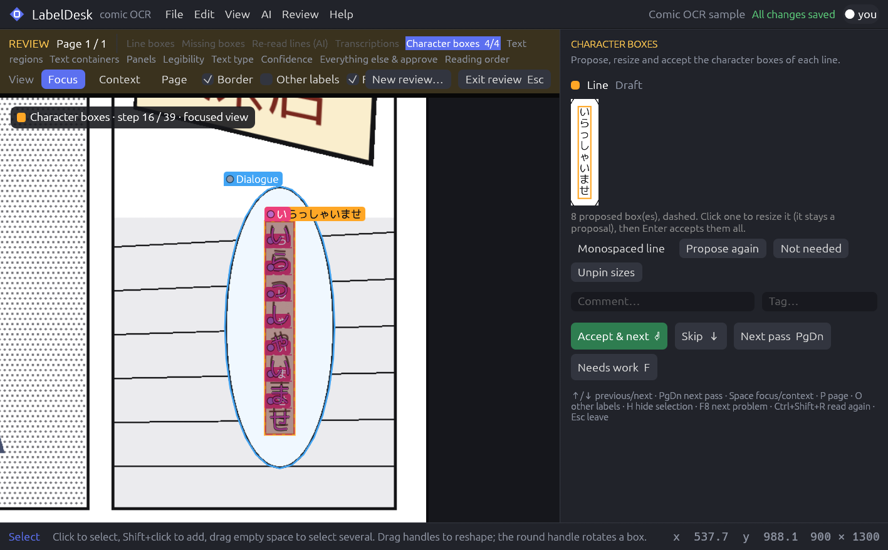
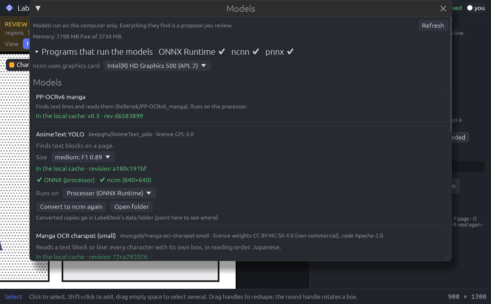

# LabelDesk — comic OCR annotation

LabelDesk is a desktop application for building **gold-standard OCR datasets from comics and
manga**. It draws and checks text at every level (panels, balloons, text regions, lines,
characters), records exact transcriptions, reading order, legibility and who verified what, and
keeps everything in plain, Git-friendly JSON files.

It runs fully offline. Optional AI models propose lines and readings (PP-OCRv6 manga), text
blocks (AnimeText YOLO), characters with their own boxes in reading order (manga-ocr-charspot),
panels, balloons, text and sound effects with their outlines (Koharu layout) and text pixel masks
(Koharu text masks); every proposal stays a proposal until a person accepts it. Models run on
the processor with ONNX Runtime, or on any graphics card with a Vulkan driver through ncnn.



## Features

- **Drawing**: rotatable boxes, quadrilaterals, polygons; resize from any edge or corner;
  Ctrl+drag a corner to distort, Ctrl+Shift+drag to skew, Ctrl+Alt+drag for perspective
  (handy to flatten slanted text); keyboard resizing (Shift/Ctrl/Alt + arrows in Review Mode).
- **Hierarchy**: page → panel → container (balloon, caption, sign) → text region → line → word
  → character. Ctrl+G groups the selected labels into a new parent of the next coarser level.
- **Character boxes**: proposed from the transcription and the line's shape (including
  perspective), sized cell by cell; monospaced lines get equal cells; two- or three-digit
  numbers in vertical Japanese share one cell, split side by side.
- **Review Mode** (F6): a per-page, multi-pass workflow you configure — line boxes, missing
  boxes, re-reading with AI, transcriptions, character boxes, text regions, containers, panels,
  legibility, text type, confidence, everything else, and finally reading order. Comments and
  tags on any label. Resumes where you left off.
- **Quick answers first, details later**: legibility and confidence take a two-way answer
  (perfectly readable / not perfectly readable, certain / uncertain) that you refine later.
- **Find** (Ctrl+F): combine any criteria (text, level, type, attribute, tag, state, problems,
  legibility, uncertainty, origin…), then select, hide, review or edit the results in bulk.
  Ctrl+click pages in the page list for bulk page actions.
- **Focus**: H hides the selection (Shift+H shows it again); View → Highlight problems outlines
  labels with validation problems; F8 jumps to the next one.
- **AI**: pre-annotate pages, read a region, read the selection again (Ctrl+Shift+R, with
  PP-OCR or charspot); find text blocks; read text regions into lines and character boxes; find
  the characters of selected lines (Ctrl+Shift+K); find panels, balloons, text and sound
  effects; mark text pixels (View → Text mask). Every run records the exact model files with
  their SHA-256 and what ran them.
- **Models window** (AI → Models…): installs the runtimes, chooses where each model runs
  (processor or graphics card), converts PyTorch-only models to ONNX and any model to ncnn.
- **Version control**: a page is committed to Git once its review is complete; unfinished pages
  stay as uncommitted changes.
- **Releases**: reproducible dataset exports (native JSON, JSONL, COCO, flattened crops) with
  checksums and train/validation/test splits.
- Pictures: PNG, JPEG, WebP, BMP, TIFF and **JPEG XL**.

## Installation

LabelDesk is written in Rust and builds into a single program.

### 1. Install Rust

Install Rust 1.85 or newer (edition 2024) from <https://rustup.rs>:

```sh
curl --proto '=https' --tlsv1.2 -sSf https://sh.rustup.rs | sh
```

### 2. System libraries

- **Linux**: a C compiler, `pkg-config`, and the usual desktop libraries for OpenGL, X11 or
  Wayland and file dialogs. On Debian/Ubuntu:
  ```sh
  sudo apt install build-essential pkg-config libgl1-mesa-dev libx11-dev libxcursor-dev \
       libxrandr-dev libxi-dev libxkbcommon-dev libwayland-dev libgtk-3-dev
  ```
  On Arch: `sudo pacman -S base-devel gtk3 libxkbcommon wayland`.
- **macOS**: Xcode command line tools (`xcode-select --install`).
- **Windows**: Visual Studio Build Tools with the C++ workload.
- **Git** (optional) to keep track of reviewed pages.

### 3. Build and run

```sh
git clone <this repository>
cd labeldesk
cargo build --release
./target/release/labeldesk                 # opens the welcome screen
./target/release/labeldesk path/to/project  # opens a project folder
```

The first build downloads the Rust dependencies (`cargo build --offline` works once they are
cached). No AI runtime is built in: the app starts the same on every processor.

### 4. AI models (optional)

Models are read from the Hugging Face cache (`~/.cache/huggingface/hub`, or
`$HF_HOME`/`$HF_HUB_CACHE`); nothing is downloaded behind your back. Download the ones you want:

```sh
pip install -U huggingface_hub
hf download Kellenok/PP-OCRv6_manga            # lines + reading (v0.2 or newer)
hf download deepghs/AnimeText_yolo             # text blocks
hf download muscgab/manga-ocr-charspot-small   # characters with boxes (CC BY-NC-SA weights)
hf download mayocream/koharu-layout-highres    # panels, balloons, text, sound effects
hf download mayocream/koharu-text-sam-ts-l     # text masks
```

Then open **AI → Models…**:



| Program | What for | Install |
|---|---|---|
| ONNX Runtime 1.31.1 | runs models on the processor | button (Microsoft's official build, 11 MB, SHA-256 checked) |
| ncnn 20261020 | runs converted models on the graphics card (Vulkan) | button (Tencent's official build, 10 MB) |
| pnnx 20261020 | converts ONNX models to ncnn | installed when you first convert |

The official ONNX Runtime runs on processors without AVX too (copies built for newer processors
are tested in a separate process first and refused instead of stopping the app).

| Model | Runs from | Graphics card |
|---|---|---|
| PP-OCRv6 manga | its ONNX files | — |
| AnimeText YOLO (n/s/m/l/x) | its ONNX files | convert to ncnn |
| manga-ocr-charspot-small | its ONNX file | not possible (decoding inside the graph); about 20 ms per crop on a processor |
| Koharu layout | **Convert to ONNX** first | then convert to ncnn |
| Koharu text masks | **Convert to ONNX** first | then convert to ncnn |

The Koharu models ship as PyTorch weights only. **Convert to ONNX** needs Python 3.10+ once:
LabelDesk makes a private environment in its data folder (PyTorch processor build and the
model's own code: RF-DETR 1.7.0 or Hi-SAM at a fixed commit, about 1 GB on disk) and runs
`convert/export_koharu.py`, which computes attention in slices so the exported model needs a
fraction of the memory. The layout model can be converted for 1920 px (its own size), 1536,
1152 or 960 px; smaller is faster and lighter but misses more small text. Each conversion
writes `conversion.json` (sources with SHA-256, tools, outputs) next to its result.

Data folder: `~/.local/share/labeldesk` (Linux), `%LOCALAPPDATA%\LabelDesk` (Windows),
`~/Library/Application Support/LabelDesk` (macOS), or `$LABELDESK_DATA_DIR`.

From the command line: `labeldesk --install onnxruntime|ncnn|pnnx`,
`labeldesk --convert animetext|layout|textmask [onnx|ncnn]`,
`labeldesk --try-model animetext|charspot|layout|textmask picture.png [onnx|ncnn-gpu|ncnn-cpu]`.

The PP-OCR version a project uses is pinned in its settings; newer cached versions are offered
but never switched silently.

## Using it

1. **File → New project…** (or open the sample project from the welcome screen), then
   **Import…** pictures. Each picture becomes a page.
2. Optionally **AI → Pre-annotate** pages.
3. Draw and correct labels (V select, B box, Q quadrilateral, P polygon, 1–6 choose the level).
4. Press **F6** for Review Mode: choose the passes and the pages, press Enter. Enter confirms a
   step and moves on, ↓/↑ skip and go back, PgDn jumps to the next pass, Esc leaves (and you
   resume later where you stopped).
5. **Review → Track this project with Git** to commit each page when its review is complete.
6. **File → Create dataset release…** to export a dataset.

All shortcuts are listed (and can be changed) in **Help → Keyboard shortcuts**.

### Review passes

| Pass | What you do |
|---|---|
| Line boxes | Check every line box; Shift/Ctrl+arrows grow/shrink a side, Alt+arrows move, Ctrl+T tightens to the ink |
| Missing boxes | Draw lines that are still missing — now, or at the end of the page (new boxes then get the passes they missed) |
| Re-read lines | Read all line boxes again with the AI model once their shapes are right |
| Transcriptions | Check each reading side by side, against the model, or blind |
| Character boxes | Propose, resize (stays a proposal) and accept the boxes of each line |
| Text regions | Accept suggested groups or group the selection with Ctrl+G |
| Text containers / Panels | Check, draw, and group balloons, captions, signs and panels |
| Legibility / Text type | One answer per text region, passed on to its lines |
| Confidence | Certain or uncertain, per line |
| Everything else | The remaining required fields, then approve |
| Reading order | Suggested inside each parent among labels of the same level; fix with Alt+↑/↓ |

### Text types and attributes

Types: Dialogue, Thought, Narration, Signage, **Secondary text** (meant to be read but not story
text: screens, notes, labels), **Background text** (part of the drawing), Sound effect, Title,
Credits, Page number, Other. Background text, sound effects, page numbers and furigana are read
outside the reading order (configurable).

Attributes are optional and configurable: handwritten, furigana, monospace, stylized, outlined,
curved. Rotation and mirroring belong to the orientation, not to attributes.

## Data format

A project is a folder:

```text
project.json                 configuration, review policy, page list
annotations/<page-id>.json   one annotation file per page
history/<page-id>.jsonl      append-only change log
images/                      the imported pictures (never modified)
schema/  FORMAT.md           JSON Schemas and the format description
releases/                    dataset exports
.labeldesk/                  local state (recovery copies, review sessions) — not versioned
```

The full description is in [docs/FORMAT.md](docs/FORMAT.md) (also written into every project).

## Development

```sh
cargo test                                  # unit, acceptance and interface tests
cargo run -- --screenshot shots/review.png  # draw ~120 frames, save a picture, exit
```

See [AGENTS.md](AGENTS.md) for the code layout and conventions.

## License

Not yet chosen; all rights reserved by the author until a license file is added.
